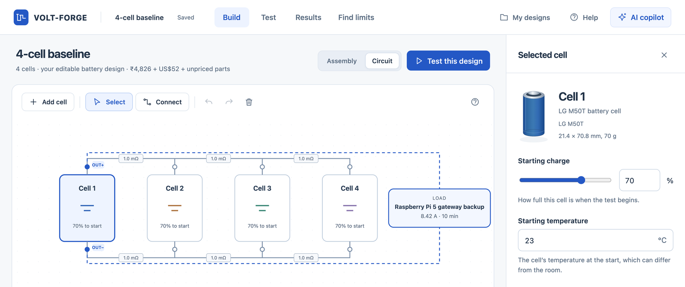
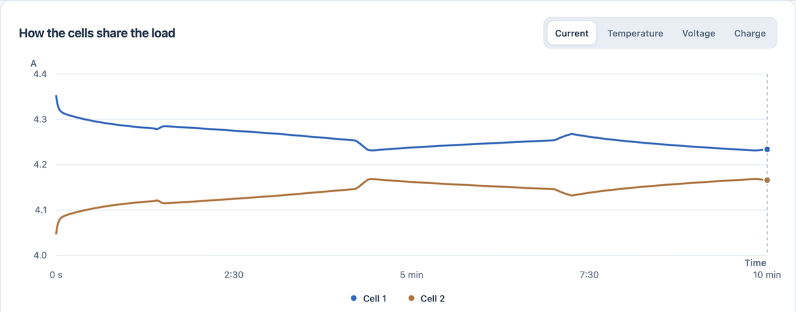
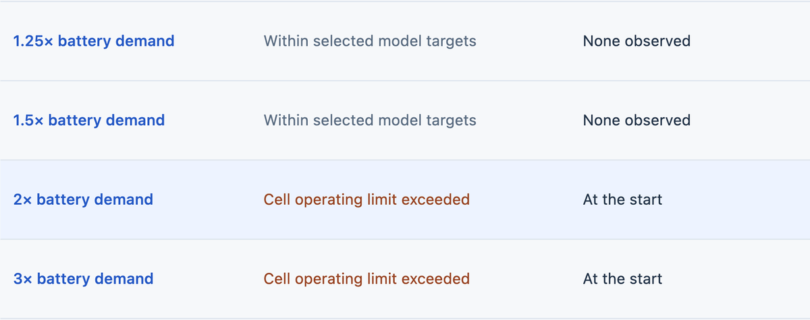
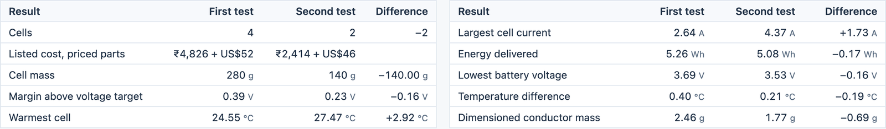

# VOLT-FORGE

**See what a battery decision changes, before you build it.**

VOLT-FORGE is a battery design workspace. Wire cells into a circuit, run their electrical and heat behaviour together, push the design to its limits and compare it with another, on published cell data, right in your browser.

**[Try it live → volt-forge-app.vercel.app](https://volt-forge-app.vercel.app)** &nbsp;·&nbsp; [Calculations and sources](https://volt-forge-app.vercel.app/appendix) &nbsp;·&nbsp; [One-minute demo video](docs/demo.mp4)

Built by **Team StratWise** (Shubhra Arora, Jai Kaushik, Sanya Bansal) for **Tata Elxsi Teliport Season 4, Case Study 2: Reusable Digital Platform for Designing Battery Energy Systems**.



---

## Why it exists

Take a cell out of a battery and it gets cheaper and lighter. Every cell left behind carries more current, runs hotter and sags closer to its cut-off. Wiring, a weak cell, cooling and the room all shift the answer again. That knowledge usually lives in separate electrical, thermal, safety and cost tools.

VOLT-FORGE puts them in one workspace, so **one change updates all of them**. Students see *why* a design behaves the way it does. Engineers and labs screen options before buying cells or booking bench time.

## What you can do

| Step | In the app |
|---|---|
| **1. Build** | Wire cells in a circuit or assembly view with sized copper links and outputs. Click any cell to set its charge, temperature, model and cooling, or import your own cell from a dataset. |
| **2. Run** | Every cell's current, voltage, charge and temperature, plus copper losses and energy, solved together through time. Exact saved samples, not just a smoothed chart. |
| **3. Break** | *Find limits* pushes demand, room temperature or connection resistance until a cell crosses a datasheet limit, and names the cell and the moment. |
| **4. Compare** | Any two saved designs side by side, after checking that load, preparation, heat assumptions, models and solver all match. |
| **Ask** | An AI copilot explains results and proposes edits. Every proposal is checked by the engine and shown as a before and after review before anything changes. |
| **Keep** | Export a report, the numerical rows, the model inputs and a replay script. Back up and re-import any design. |

| Run | Break |
|---|---|
|  |  |



## Worked example: a Raspberry Pi 5 backup

A Raspberry Pi 5 gateway must stay on through a 10-minute power cut on LG M50T cells wired in parallel.

- **Requirements:** 25 W (the Pi's recommended 5 V, 5 A supply), 10 minutes, battery never below 3.3 V, 23 °C room, 70% charge at the cut, 90% converter efficiency.
- **Sizing current:** 25 W ÷ (0.90 × 3.3 V) = **8.42 A**, held for the full 10 minutes.
- **Study:** a frozen plan of **4,006 simulated stress cases** across 1 to 4 cells and four wiring options, with a weak cell in every position, poorer cooling, worse contacts, a hotter room, lower charge and a weaker converter.

| Cells | Stress cases survived | Busiest cell, worst case | Hottest cell, worst case | Cell cost |
|---|---:|---:|---:|---:|
| 4 (starting design) | 51 / 51 | 3.34 A | 26.1 °C | ₹4,824 |
| 3 | 42 / 42 | 3.86 A | 27.7 °C | ₹3,618 |
| **2** | **33 / 33** | **5.49 A** | **31.8 °C** | **₹2,412** |
| 1 | 0 / 15 | Refused: 8.42 A is above one cell's 7.275 A limit | | ₹1,206 |

Two cells with the negative output moved to the far cell do the same job with **half the cell cost and weight**, and the worst cell current drops to 5.33 A. Costs and masses are cells only (₹1,206 and 70 g each). The study protocol is in [`configs/round1_design_study_v2.json`](configs/round1_design_study_v2.json) and the summary in [`reports/final_release_v1/study/summary.json`](reports/final_release_v1/study/summary.json).

## Under the hood

| | |
|---|---|
| **Engine** | Each cell is an open-circuit voltage source, a series resistance and three RC pairs whose values shift with charge and temperature. A network solver shares the current through the real copper links; a lumped heat model feeds temperature back every 0.5 s. |
| **Data** | Published LG M50T tables (Imperial College, PyECN), measured heat capacity (Steinhardt et al.), and the 54-experiment parallel-module dataset by Piombo et al. (194 files checksum-verified). See [`ATTRIBUTION.md`](ATTRIBUTION.md) and [`third_party/`](third_party). |
| **Checked against PyBaMM** | The solver matches PyBaMM, the open-source battery modelling package, on all 15 electrical and heat reference cases. |
| **Repeatable** | All 4,006 study cases were re-run on the final build: 27,832 of 27,832 stored numbers identical. 515 Python and 74 JavaScript tests pass. |
| **Physics check** | Every one of the 3,964 calculated cases closes its energy balance. |
| **Runs in the browser** | The same Python engine runs on the public site through Pyodide (WebAssembly). The optional AI uses `openai/gpt-oss-120b` on Groq with a small source-labelled retrieval layer. |

Receipts: [`reports/final_release_v1/`](reports/final_release_v1).

## Run it locally

Python 3.12:

```sh
python3.12 -m venv .venv
.venv/bin/python -m pip install -r requirements-lock.txt
.venv/bin/python scripts/run_editor.py --project workspace/my_project --port 8794
```

Open http://127.0.0.1:8794. There is no frontend build step. On Windows use `.venv\Scripts\python.exe`.

Run the tests:

```sh
PYTHONPATH=src .venv/bin/python -m pytest -q
```

## Repository map

| Folder | What is in it |
|---|---|
| `src/voltforge/` | Engine: cell models, coupled electrical and thermal solver, studio, projects |
| `web/editor/` | The workspace UI (vanilla JavaScript, no build step) |
| `site/` | Public site: welcome page, in-browser engine bridge, AI route |
| `configs/` | Frozen study protocols, data sources, cell catalogue, prices |
| `scripts/` | Run the editor, reproduce the study, rebuild the public site |
| `reports/` | Saved study results, verification receipts and model evidence |
| `tests/` | Python test suite |
| `docs/` | Product and interface notes, images, demo video |

## Scope

This is a Round 1 prototype focused on one parallel cell group. Results are simulations under the stated assumptions. Full packs, ageing, CFD and hardware integration are on the roadmap.
